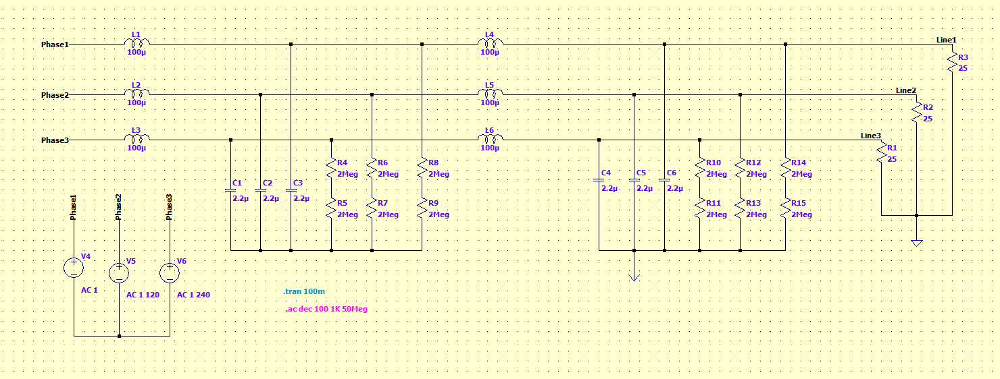

# Three-Phase EMI Filter (`0026_emi_filter`)

LTspice model of a two-stage, three-phase LC EMI filter driving a balanced resistive load.

## Circuit

| Part | Ref. | Value | Notes |
|---|---|---|---|
| Stage 1 series inductors | L1, L2, L3 | 100 µH | One per phase |
| Stage 1 X-capacitors | C1, C2, C3 | 2.2 µF | Star-connected; floating star point |
| Stage 1 bleeder resistors | R4–R9 | 2 MΩ | Two in series per phase (4 MΩ) to the star point |
| Stage 2 series inductors | L4, L5, L6 | 100 µH | One per phase |
| Stage 2 X-capacitors | C4, C5, C6 | 2.2 µF | Star-connected; star point grounded |
| Stage 2 bleeder resistors | R10–R15 | 2 MΩ | Two in series per phase (4 MΩ) to the star point |
| Load | R1, R2, R3 | 25 Ω | Star-connected to ground |
| Sources | V4, V5, V6 | AC 1 ∠0°, 120°, 240° | Balanced three-phase input |

Each stage is a per-phase L-C low-pass section, resonating at

f₀ = 1 / (2π√(LC)) = 1 / (2π√(100 µH · 2.2 µF)) ≈ 10.7 kHz

Cascading the two stages gives an ideal roll-off of −80 dB/decade above resonance.

## Simulations

The schematic holds two analysis directives. LTspice runs whichever one is enabled.

- `.ac dec 100 1K 50Meg`: small-signal frequency response from 1 kHz to 50 MHz, 100 points per decade. Use it to read the filter's insertion loss at `Line1`–`Line3`.
- `.tran 100m`: 100 ms transient run.

## Files

| File | Description |
|---|---|
| `ac_filter.asc` | LTspice schematic (the source) |
| `ac_filter.raw`, `ac_filter.op.raw` | LTspice simulation results |
| `ac_filter.log` | LTspice run log |
| `docs/schematic.png` | Schematic screenshot |

## Usage

1. Open `ac_filter.asc` in [LTspice](https://www.analog.com/en/resources/design-tools-and-calculators/ltspice-simulator.html).
2. Run the simulation.
3. Probe the `Line1`, `Line2` and `Line3` nodes to see the filtered output.
